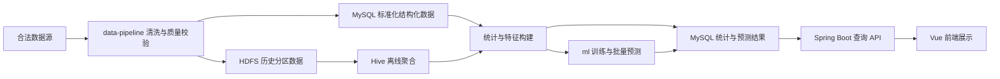

# 初步系统架构

状态：**规划，尚未实现**。本文件规定模块职责与交接边界，具体表结构、字段和 API 需后续契约设计确认，不代表服务已运行、性能已达标或第三方资料中的功能已完成。本文不调整正式人员分工；用户的分工意向另记于 [S1 阶段报告](../stage-reports/S1.md)，待总规划师确认。

## 产品边界与数据准入

系统面向城市道路交通运行分析及通勤高峰代理指标预测。候选输入是道路速度、流量和拥堵相关数据；没有已确认的真实个人 OD（起讫点）或通勤人数数据，不把道路流量解释为通勤人数，也不从代理指标推断个人行程。

数据接入前应记录来源、许可、覆盖区域、时间范围、采样频率、单位及缺失情况。只有授权明确且字段可解释的数据才能进入正式链路；第三方毕业设计不直接复刻，原始 ZIP 和未授权数据不进入仓库。原始数据的实际存储位置和访问策略待数据源评审确定。

## 模块数据流与交接产物

Hadoop（HDFS）与 Hive 属于原总规划的大数据技术目标，须在对应大数据阶段实施并提交验证证据，不因数据规模较小而自行省略或降为可选组件。MySQL、HDFS 和 Hive 承担不同职责，不表示每份输入都必须复制到所有存储中。部署方式、资源配额、数据保留期和分区粒度可依据数据规模在后续设计中确认；技术范围的调整须另行提交总规划师审批，本文不作缩减。

| 交接环节 | 产出与消费关系 | 边界及待确认事项 |
|---|---|---|
| 数据源 → data-pipeline | 清洗模块接收授权输入，产生标准化记录、质量摘要和拒绝记录原因 | 校验时区、道路标识、单位、重复及缺失；异常记录不应静默进入结果 |
| data-pipeline → database / bigdata | 合格记录进入约定存储；database 维护 MySQL 迁移，bigdata 维护 HDFS 布局和 Hive DDL | 存储字段遵循 contracts；分区、导入幂等键与历史修订策略待设计 |
| MySQL / Hive → 统计及 ml | 聚合数据用于统计展示或构建预测特征 | 明确时间窗口、区域粒度和聚合口径；训练不得使用预测时点之后的信息 |
| ml / 统计任务 → MySQL 结果 | 写入可供查询的统计或预测结果及其版本信息 | 预测目标、预测时点、目标时间范围、数据截至时间和模型版本须可区分 |
| MySQL 结果 → backend | Spring Boot 服务读取已发布结果并按契约组织响应 | 在线接口不直接扫描 HDFS、不执行 Hive 作业或训练；查询权限与性能策略待设计 |
| backend → frontend | Vue 通过 API 获取统计、趋势和预测结果 | 前端不直连数据库，不接触数据库凭据，不重新定义指标口径 |

## 接口与配置边界

- **contracts 是模块交接依据。** 后续在此维护字段字典、API 描述和小型虚构样例，至少明确道路/区域标识、时区、时间窗口、单位、指标定义、空值语义和版本兼容性。本文不提前冻结具体字段名或 URL。
- **database 管理存储结构，生产者管理任务输出。** 清洗、统计和预测任务按约定写入；backend 按结果契约查询。结构变更需提供迁移与兼容说明，不能由单一模块静默改表。
- **API 需区分无数据与真实零值。** 后续确认道路/区域、时间范围和指标筛选，分页或点数限制、错误响应，以及结果版本和更新时间的表达。缺失或过期结果不得伪装成当前观测值。
- **frontend 负责展示与交互。** 应显示数据覆盖范围、更新时间、预测范围及代理指标说明；速度、流量等观测与预测须可辨识。
- **infra 与 scripts 支撑执行。** 环境配置模板与检查命令使用同一配置约定；真实凭据仅保留在本地或受控部署环境，不能进入 VITE_* 公开变量或仓库。权限、调度工具和部署拓扑尚待选择。

## 离线计算与在线查询

| 维度 | 离线链路 | 在线链路 |
|---|---|---|
| 触发 | 计划中的批次调度或受控手动任务 | 用户通过 Vue 发起查询 |
| 工作 | 清洗、Hive 聚合、特征、训练、评估、批量预测 | 参数校验、读取已发布结果、组织 API 响应 |
| 输出 | 质量摘要、版本化统计/预测结果与任务状态 | 既有结果及其覆盖时间、更新时间和状态 |
| 失败处理 | 保留失败原因；幂等重试和补数策略待实现 | 按契约返回失败、缺失或过期状态，不临时启动训练补救 |
| 耗时边界 | 可执行历史数据批量处理，资源预算待评估 | 不承担大规模计算；响应目标、缓存与索引待测量确定 |

建议离线结果先完成质量校验，再发布可查询的批次，避免前端读到半批数据。应记录任务批次、数据版本、时间范围和发布状态；失败时是否继续提供上一成功批次及其过期提示，须在契约阶段确认，当前没有实现事务发布或自动回退。

机器学习评估应按时间划分训练、验证和测试，保留基线比较与误差说明。模型文件与训练产物留在受控存储；在线 API 只查询预测结果，不在用户请求内加载并训练模型。训练频率、目标指标、算法及验收阈值均未确定。

## 当前交付与后续设计入口

当前已有工程骨架、安全配置、协作规范及 GitHub 私有仓库，PR #1 已创建且等待真实审核；S1-WP5 仅整理阶段验收材料。以下内容均**尚未实现或验证**：

- 已授权数据接入、清洗作业、质量校验和补数流程。
- MySQL 表结构及迁移、HDFS/Hive 环境与聚合任务。
- 正式 API 契约、Spring Boot 服务、鉴权和 Vue 页面。
- 预测目标定稿、模型训练、评估、预测结果发布。
- 服务启动、业务测试、性能测试、调度与部署运行。

后续应先确认需求、授权数据与共享契约，再按阶段任务实现和验证各链路。架构中的建议需总规划及相应设计评审确认，不因本 PR 创建而视为已开发或整个 S1 已验收。
