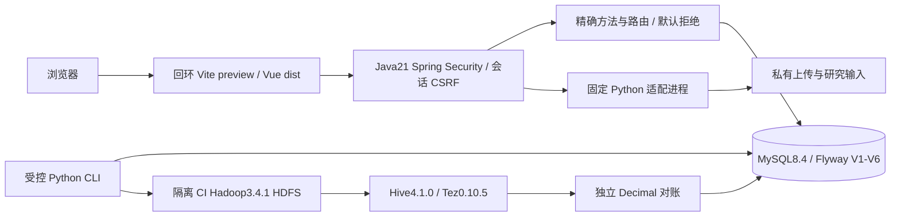
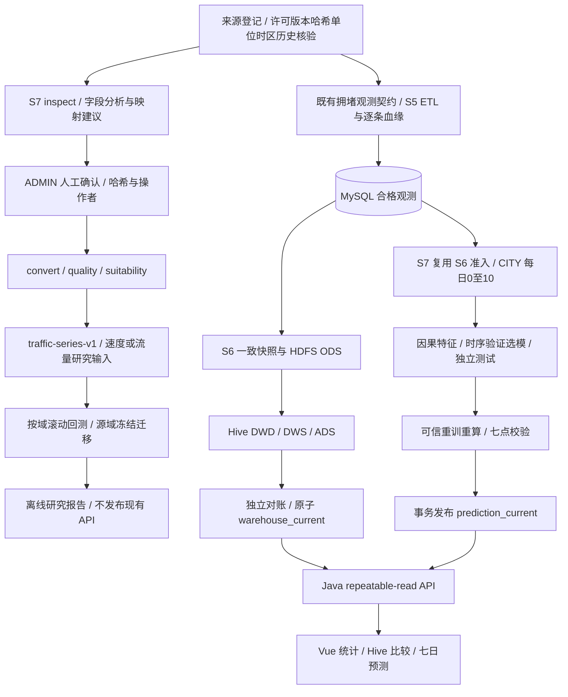

# 系统架构与数据流（S9）

当前已实现 Python ETL、MySQL/Flyway V1–V6、HDFS/Hive、离线 ML、Java API、Vue/ECharts、会话认证与受保护研究导入。S7/S8 已验收合并，S9 提交独立验收；真实数据交付仍受[来源台账](../../ml/DATA_SOURCES.md)门槛约束。没有真实个人 OD 或通勤人数，不从道路代理指标推断个人行程。

## 单机候选部署

Java、Web、MySQL 在本机回环运行；本机没有可用 Hadoop/Hive/Docker，因此真实数仓继续由锁定 digest 的既有隔离 Linux CI 验证。JRE17 在 Hive 容器内，Java21 在宿主运行后端。未增加 Compose、宿主端口、生产集群或公网服务。`scripts/s9_runtime.py` 只持有自己的 Java/Web 子进程；Ctrl+C 停止它们，不停止 MySQL/HDFS。Vite preview 用于候选演示，不是互联网生产服务器。

## 实际数据流与两种契约

研究输入与正式观测是不同契约。S8 成功导入不自动调用 S5、不写共享观测、不触发 Hive/训练，也不修改两个 current 指针。没有通过真实许可/适用性门槛的来源，流程应停在阻塞点。S9 不把合成链路或分离的研究/发布契约描述为真实数据闭环；未来数据必须分别满足目标契约，不能将 speed 改名为 congestion_index。

S5 幂等导入与崩溃恢复、S6 对账与事务切换、S7 防泄漏及可信重放均保留。Hive 聚合不是 S7 每次训练必需重新计算的输入；S7 直接从已准入 CITY 观测构建日序列，不虚构 Hive 特征消费。在线请求只读已发布结果，不扫描 HDFS、不训练。

## 权限与存储边界

八个公开只读路径（含 health）见[权限清单](../guides/s9-security.md)；auth 入口仅特定方法公开，tasks 为 ADMIN/READER，四种写接口为 ADMIN+CSRF，未知路由默认拒绝。拒绝层保留统一错误封套、requestId、审计及只读路由405/Allow；未列入规则的新 Controller 不可执行。

原始外部文件在忽略的 `data/raw/`；上传与 dump 在忽略的 `data/private/`；原始外部数据不进入 Git/CI/附件。MySQL 迁移、合成 fixture、精选汇总证据可版本化。数据库备份含账号哈希/审计/样例，属于私有材料；Git 仅保留各表行数/内容哈希和恢复结果。详见[部署与恢复](../guides/s9-deployment.md)。
